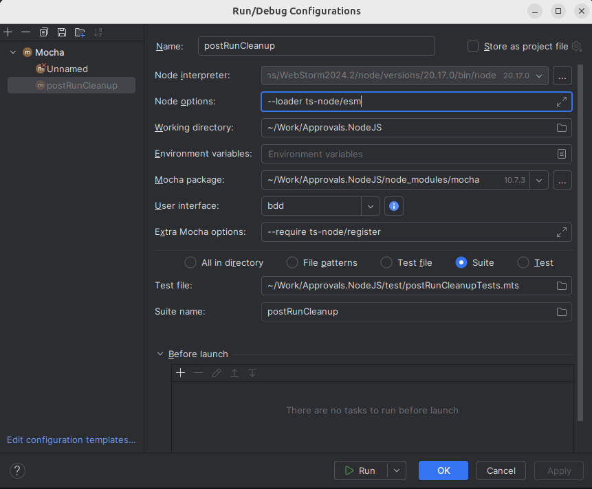

# How to run ESM tests in WebStorm



Compile the TypeScript tests before running Mocha:

```
npm run build
```

In WebStorm's Mocha configuration, select the generated `.mjs` test files
instead of the `.mts` source files. The repository's `.mocharc.js` already
selects compiled `.js` and `.mjs` tests when running the full Mocha suite.

No TypeScript loader is needed. Add `npm run build` as a Before launch step
to rebuild the tests whenever their source changes.
